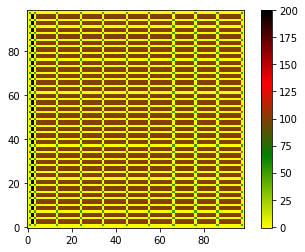
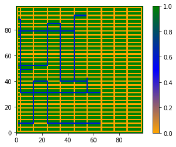
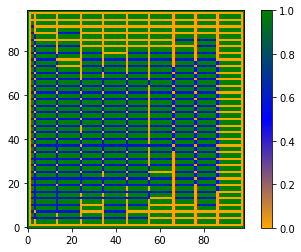

# Traffic Avoidance Path Planning for AMRs in a Warehouse

Code for the paper **"A Traffic Avoidance Path Planning Method for Autonomous Vehicles in a Warehouse Environment"**, presented at the **2021 Winter Simulation Conference (WSC)**.

> S. S. Bhattathiri, M. P. Li, and M. E. Kuhl. In *Proceedings of the 2021 Winter Simulation Conference*, 2021. DOI: [10.1109/WSC52266.2021.9715318](https://doi.org/10.1109/WSC52266.2021.9715318)

<p>



</p>

## The idea

Autonomous mobile robots (AMRs) in a large warehouse often plan their own paths (*decentralized* planning) without knowing exactly where every other robot is. When several robots use the same aisle, they slow down and congestion builds.

This project gives a newly dispatched AMR a **traffic prediction** step before it plans:

1. The task manager tells the new AMR only the **start, pick-up and drop-off locations** of the other active AMRs. No live positions or planned paths are shared.
2. A **neural network** predicts which *zones* (aisle and highway segments between intersections) those AMRs are likely to occupy. This is a multi-label classification over all zones in a single forward pass.
3. **A\*** then plans the new AMR's route, treating heavily used zones as obstacles. Several traffic thresholds are tried, and the route with the smallest expected travel time (distance plus congestion delay) is chosen.

## Warehouse model

- A 200,000 sq. ft warehouse with 64 dock locations, converted to a grid of 100 × 100 cells. The layout file used in the code is 99 × 99.
- The layout is encoded as a matrix: `0` = free aisle, `50` = intersection, `100` = rack, `200` = dock, `-1` = wall. See [`data/Layout_updated_2021.csv`](data/Layout_updated_2021.csv).
- AMRs move one cell per time step in 4 directions. When *m* AMRs share a zone, each step inside it takes *m* time steps.

## Method details

- **Training data:** random start, rack and dock locations. Paths are computed with A\*, and each zone is labelled occupied or not occupied.
- **Model:** a shallow fully connected network with 4 dense layers and sigmoid outputs, one per zone. SVMs, random forests and deeper networks were also tried but did not train well.
- **Class imbalance:** more than 95% of zones are empty in any sample. This is handled with output-bias initialisation and sample weights (a weighted hinge loss).
- **Metrics:** accuracy, precision, recall, Hamming loss and Matthews correlation coefficient.

## Results (from the paper)

In a Monte Carlo experiment with 5 active AMRs over 100 trials:

| Algorithm | Travel time (mean ± SD) | Travel distance (mean ± SD) |
|---|---|---|
| A\* | 229.97 ± 77.60 | 160.25 ± 46.96 |
| **Traffic avoidance + A\*** | **180.53 ± 59.81** | 214.34 ± 104.26 |

Traffic avoidance cut the average travel time by about 21%, even though it takes longer routes. In the 39 trials where it chose a different path from plain A\*, it saved **126.76 time units on average**. With sample weights, the traffic predictor reached a test recall of 0.75.

## Repository contents

| Path | What it is |
|---|---|
| `src/PathPlanner.py` | Grid A\* planner (4-connected) |
| `src/TrafficPredictionPathPlanning.py` | Reads the layout, defines zones and intersections, generates multi-agent A\* paths, and counts AMRs per zone |
| `src/CreatingData.py` | Generates the training dataset (start/finish zones → zone occupancy) |
| `src/MachineLearning.py` | Trains and evaluates the multi-label traffic-prediction network, including the weighted-loss and bias-initialisation experiments |
| `src/Rest_of_code.py` | Monte Carlo simulation comparing A\* with traffic-avoidance A\* (travel time, distance, conflicts) |
| `notebooks/` | The original Google Colab notebooks from 2021, with outputs and plots |
| `data/Layout_updated_2021.csv` | Warehouse layout matrix |
| `results/` | Raw output arrays from a 27 June 2021 simulation run (travel times, distances and conflicts, with and without traffic avoidance). These are working outputs, not the final numbers in the paper's Table 5. |
| `figures/` | Plots exported from the notebooks |

## Running it

The code was written in 2021 in Google Colab and PyCharm and is kept as it was used, so expect research-code rough edges:

- File paths are hard-coded to the original machine, such as `D:/...` or `/content/gdrive/Shareddrives/...`. Point them at `data/Layout_updated_2021.csv` and your own output folder before running.
- The 150,000-sample training set (`data_for_training150000_1v_1t.pkl`, about 1.9 GB) isn't included. Regenerate it with `src/CreatingData.py`.

```bash
pip install -r requirements.txt
cd src
python CreatingData.py      # generate training data (edit paths first)
python MachineLearning.py   # train and evaluate the traffic predictor
python Rest_of_code.py      # run the traffic-avoidance vs. A* simulation
```

## Authors

Sriparvathi Shaji Bhattathiri, Maojia P. Li and Michael E. Kuhl, Rochester Institute of Technology.

The A\* implementation follows the structure of Sebastian Thrun's A\* examples, as credited in `PathPlanner.py`.
